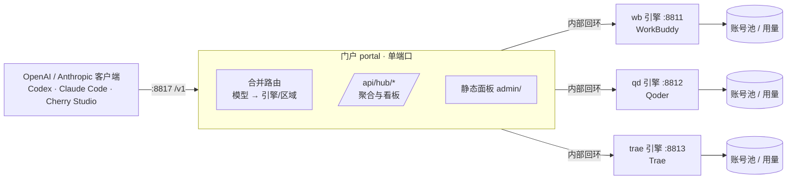

<div align="center">

# WorkBuddy × Qoder × Trae-hub

**把三套 AI 客户端登录态，合成为一个本地 OpenAI / Anthropic 兼容网关**

[](https://github.com/shuishuipingan/workbuddy-qoder-trae-hub/releases)
[](./LICENSE)
[](https://www.python.org/)
[](https://github.com/shuishuipingan/workbuddy-qoder-trae-hub/pkgs/container/workbuddy-qoder-trae-hub)
[](#-快速开始)

**一把 Key 调三家 · 一个面板管全部 · 一个端口对外**

</div>

---

## 这是什么

`WorkBuddy`、`Qoder`、`Trae` 三家的客户端各自带一套反代网关，各管各的账号、各开各的端口、各有一套看板。
同时用三家的时候，你得开三个窗口、记三套地址、把同一个客户端配置三遍 —— 而且一个账号挂了，客户端只会报错，不会自己换到另一家。

本仓库把这三套**原样收进 `hub/engines/`**（一行未改，只在固定的 `hub-patch` 标记块里补了错误处理与提示），
在它们上面加了一层**融合层 `hub/`**，把「三家」对外收敛成「一家」：

| 收敛到什么 | 具体是什么 |
|---|---|
| **一个进程** | 三家引擎在同一个 Python 进程里跑，模块名前缀天然隔离（`wb_*` / `qoder_*` / `trae_*`），互不污染 |
| **一个端口** | 只有 `8817` 对外；三家引擎的端口仅监听 `127.0.0.1`，外部连不上 |
| **一把 Key** | 合并 Key 按「模型在谁家、哪个区可用」自动选路；`401/429/502/503/504` 自动换下一家，客户端无感 |
| **一个面板** | 账号池、模型清单、数据指标、请求流水、网关 Key、福利中心、设置在同一个 React 看板里 |
| **一套协议** | 对外统一 OpenAI Chat / Responses 与 Anthropic Messages（含 SSE 流式），客户端填同一个 `base_url` |

**能接什么客户端**：Codex、Claude Code、Cherry Studio、ChatBox、LobeChat、NextChat、任何支持自定义 `base_url` 的 OpenAI 兼容客户端，
以及 Anthropic 协议的客户端（走 `/v1/messages`，`x-api-key` 与 `Authorization` 都认）。

**升级不会丢数据**：账号、用量、日志、面板设置全部落在本地，一键更新只覆盖代码路径。

## 架构



**请求路径**：客户端 → 门户（鉴权 + 选路）→ 引擎（选号 + 上游协议）→ 上游。
**看板路径**：浏览器 → 门户 `/api/hub/*`（一次拿三家）→ 引擎 `/usage`、`/accounts`。

## 功能

### 网关

- **合并 Key**：一把 Key 调三家；按模型可用性选引擎与区域，`401/429/502/503/504` 自动换下一家
- **Key 作用域**：每把合并 Key 可限制「只用哪些模型」「只用哪些引擎」，越权返回 `403 model_not_allowed` / `503 engine_not_allowed`
- **协议**：`/v1/chat/completions`、`/v1/responses`、`/v1/messages`（Anthropic，含 `x-api-key`）、`/v1/models`
- **流式**：SSE 边收边发；已向客户端写出字节后**绝不重发**（避免同一个回答来两遍）
- **别名**：`/v1/*` 与 `/api/v1/*` 等价，客户端填哪个都行

### 面板

| 页面 | 内容 |
|---|---|
| 总览 | 三家健康、合并 Key 数、路由统计、自检 |
| 账号池 | 三家账号统一列表：签到状态、积分（含增减）、出口区域、启停、测试、导入、批量签到 |
| 模型清单 | 三家模型合并去重，标出可用性 |
| 数据指标 | 区间切换（今天/7 天/30 天/本月/全部/自定义）+ 6 项 KPI + Top 账号/模型/提供商 + 活跃热力图 + 缓存命中率 + 趋势图 |
| 请求流水 | 三家日志合并、按级别/引擎过滤、详情与复制 |
| 网关 Key | 引擎 Key 与合并 Key 的管理（含作用域、一键测试） |
| 福利中心 | 每日签到、Token 保活、权益刷新 |
| 设置 | 限额四护栏、面板密码、代理槽位、定价、高级设置（引擎全部开关）、**版本与更新** |

### 运维

- **一键更新**：面板里检查 GitHub Release → 立即更新（只覆盖代码，**账号/用量/设置一律不动**）→ 自动重启
- **同步上游**：`python hub/tools/sync_upstream.py --wb --qd --trae`，带逐字节校验
- **发布闸门**：`python hub/tools/release_check.py`（前端 75 项 + hub 324 项判据 + 上游一致性 + 重启不丢数据 + 写失败可诊断）

## 快速开始

### Windows

```bat
:: 双击
WorkBuddy x Qoder x Trea-hub.bat
```

首次启动会自己建目录、起三家引擎、打印入口地址与合并 Key。浏览器打开 <http://127.0.0.1:8817>，面板密码默认 `admin`（登录后请立刻改）。

### Linux / macOS

```bash
./start-hub.sh          # 前台
./start-hub-lan.sh      # 允许局域网访问（会强制要 Key）
```

### Docker

```bash
docker run -d --name wqt-hub \
  -p 18791:8817 \
  -v "$PWD/data:/app/data" \
  ghcr.io/shuishuipingan/workbuddy-qoder-trae-hub:latest
# 宿主机 18791 → 容器门户 8817；另外 18789/18790/18792 是三家引擎（调试时才用）
```

或 `docker compose up -d`（见仓库内 `docker-compose.yml`）。

### 客户端怎么填

```
Base URL : http://127.0.0.1:8817/v1
API Key  : 面板「网关 Key」里那把合并 Key（mrg-…）
Model    : auto，或任意一家模型的名字
```

## 目录结构

```
hub/
  __init__.py          版本与引擎注册表（唯一真源）
  server.py            单进程编排：起三家引擎 + 门户
  core/
    portal.py          单端口门户：路由、鉴权、SSE 透传、聚合 API
    router.py          合并路由：模型 → 引擎/区域，快照与冷却
    aggregator.py      读端聚合：/api/hub/*
    settings.py keys.py paths.py
    updater.py         版本检查与一键更新（只覆盖代码，不动数据）
  engines/{wb,qd,trae}/ 三家引擎（原样收编，只留 hub-patch 标记块）
  tools/               同步、校验、发布闸门、面板部署
  tests/               23 个套件 / 324 条判据
admin/                 React 19 + Vite 面板（static/ 是构建产物，可直接跑）
docs/merge/            融合工程笔记（设计、接口样本、验收矩阵）
```

## 与上游的关系

本仓库是**融合层**，三家引擎的著作权归各自上游项目所有，按原许可证使用：

| 引擎 | 上游 | 说明 |
|---|---|---|
| WorkBuddy | `ardeyouxipianyi/workbuddy2api-hub` | 原样收录，补错误处理块 |
| Qoder | `shuishuipingan/qoder2api-hub` | 同上 |
| Trae | `trae2api-hub` | 同上 |

融合层（`hub/`、`admin/`、`docs/`）以 MIT 发布，见 [LICENSE](./LICENSE)。

## 数据与隐私

- **账号、用量、日志、面板设置全部落在本地**，仓库里不含任何真实账号、Key 或用量数据
- `.gitignore` 硬性排除 `accounts/`、`usage/`、`logs/`、`state/`、`hub/settings.json`
- 面板密码默认 `admin`，**局域网模式下强制要求 Key**，首次启动自动生成并持久化
- 一键更新只覆盖代码路径，数据路径在 `updater.PROTECTED` 里写死跳过

## 致谢

- 三家引擎的上游作者
- 面板视觉与交互参考了 Linear / Vercel 的产品语言
- 统计页版式参考了 Agent2API 的报表设计

<div align="center">

**如果这个项目帮你省了切换账号的时间，点个 ⭐ 就够了**

</div>
